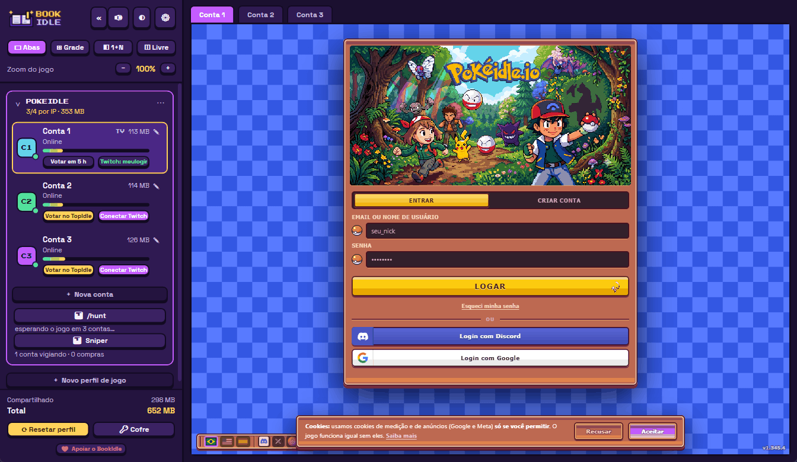
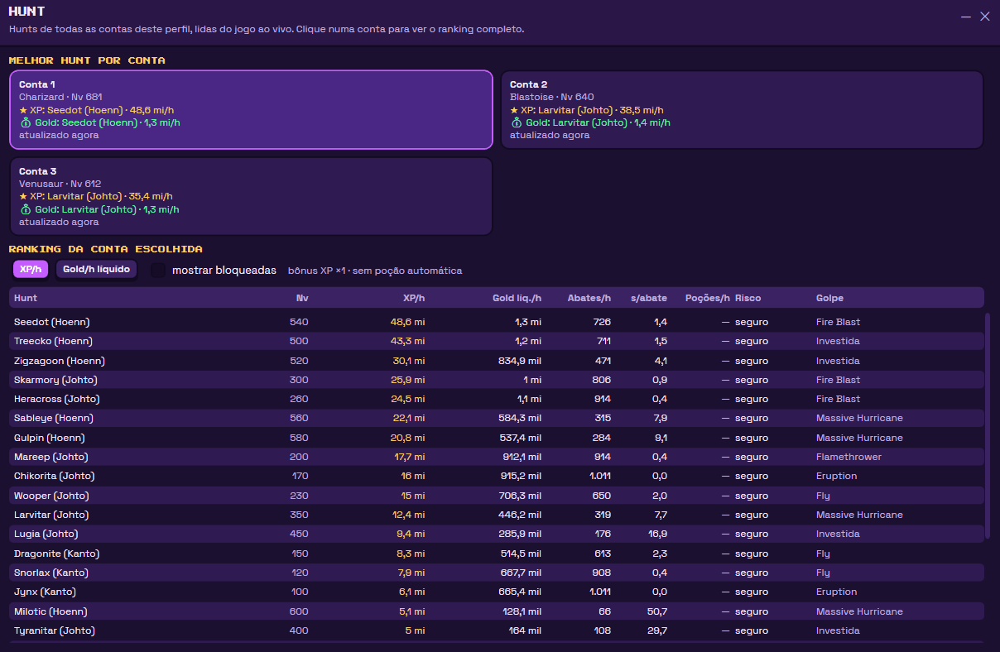
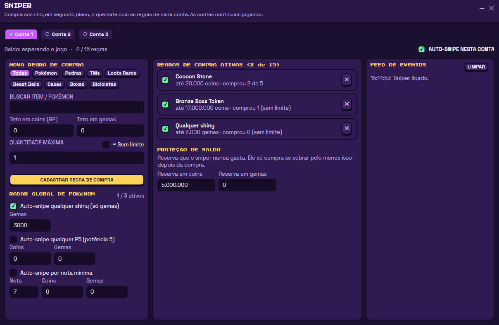

# BookIdle

**🌐 Language / Idioma / Idioma:** [Português](README.md) · [English](README.en.md) · **Español**

**Gestor de cuentas y herramientas para [pokeidle.io](https://pokeidle.io)** — varias cuentas lado a lado, captura automática, voto en TopIdle, bonos de
directos de Twitch, ranking de hunts y sniper del mercado. Programa de Windows, de código abierto y gratuito.

> **Proyecto no oficial.** BookIdle no tiene ninguna relación con pokeidle.io, TopIdle, Twitch, Nintendo ni The Pokémon Company; todas las
> marcas pertenecen a sus respectivos dueños. Úsalo bajo tu propia responsabilidad y respeta las reglas del juego (consulta [Uso responsable](#uso-responsable)).

<p align="center">
  
</p>

<p align="center">
  
</p>

<p align="center">
  
</p>

<sub>Capturas con datos de ejemplo (cuentas, saldos y hunts ficticios). La propia aplicación está disponible en portugués, inglés y español.</sub>

---

## Descargar e instalar

1. Descarga el **[BookIdle-win-Setup.exe](https://github.com/PatrickKenji/BookIdle-releases/releases/latest/download/BookIdle-win-Setup.exe)**
   (o mira todas las versiones en [Releases](https://github.com/PatrickKenji/BookIdle-releases/releases)).
2. Ejecuta el instalador. Se instala solo para tu usuario (sin pedir administrador) e instala WebView2 si falta.
3. La primera vez Windows puede mostrar **"Windows protegió tu PC"**: el instalador no tiene firma digital de pago. Haz clic en
   **Más información → Ejecutar de todas formas**. Si prefieres, el código está aquí para que lo revises y lo compiles tú mismo.

BookIdle **avisa cuando hay una versión nueva**: comprueba al abrir y cada hora, muestra lo que cambia y solo se actualiza cuando haces clic
en **Actualizar**, descargando solo lo que cambió. Después de reiniciar, muestra las novedades de la versión en detalle.

Requiere **Windows 10 u 11**.

---

## Privacidad y seguridad

**Los autores de BookIdle no tienen acceso a tus cuentas, contraseñas ni datos.** No existe ningún servidor nuestro: la aplicación se
ejecuta entera en tu ordenador y **no se nos envía nada**.

- **Todo se queda en tu PC**, en la carpeta `%LOCALAPPDATA%\BookIdleData`: ajustes, reglas, inicios de sesión de las cuentas y contraseñas.
- **Cada cuenta tiene su propio navegador aislado** (WebView2): las sesiones y las cookies de una cuenta no se mezclan con las de las
  otras ni con las de tu navegador.
- **Cofre de contraseñas opcional**, cifrado en tu PC: con tu usuario de Windows (DPAPI) o con una **contraseña maestra** (AES-256-GCM,
  clave derivada con PBKDF2 y 600 mil iteraciones). En las cuentas de **Google**, BookIdle nunca escribe la contraseña de Google: como
  mucho elige la cuenta de la lista, y el resto queda de tu parte.
- **Sin telemetría, sin análisis de uso, sin informes de errores enviados.** Las únicas direcciones con las que la aplicación contacta son:
  - `pokeidle.io` — el propio juego y la lista pública de objetos (`/assets/items.json`);
  - `topidle.com` — la página de voto, en la ventana de voto (quien vota eres tú; la aplicación no hace clic en nada);
  - `twitch.tv` e `irc-ws.chat.twitch.tv` — solo si conectas Twitch (ver abajo);
  - `github.com` — para comprobar si hay una versión nueva y descargarla;
  - `livepix.gg` — solo si haces clic en "Apoyar".
- **El código es abierto**: cualquiera puede leer y comprobar todo esto aquí. Descarga BookIdle solo desde esta página.

**Sobre Twitch:** inicias sesión en Twitch desde el propio sitio, dentro del navegador de la cuenta. La aplicación usa el inicio de sesión
que queda allí (en tu PC) para entrar en los chats de los canales de bono con una conexión ligera, **sin abrir un navegador por canal**.
Ese inicio de sesión solo se envía a Twitch.

---

## Funciones para pokeidle.io

### Cuentas lado a lado
- **Varias cuentas** en el mismo programa, cada una en un navegador aislado, con el estado de cada una (en línea, memoria) a la vista.
- **Tres modos de ventana:** **Pestañas**, **Cuadrícula** (todas las cuentas visibles) y **1+N** (una grande y las otras pequeñas).
  Atajos: `Ctrl+1` a `Ctrl+3`.
- **Arrastrar para reordenar** las cuentas, en la lista del lateral y en las ventanas.
- **Botón de expandir (⛶)** en cada ventana: pasa al modo Pestañas ya en la cuenta elegida.
- **Sonido:** silenciar todo, o silenciar cada cuenta (🔊/🔇 en la cabecera de cada ventana y en el menú de la cuenta).
- **Tema** Arcade (morado) u Oscuro (`Ctrl+T`), **menú plegable** (`Ctrl+B`) y **zoom** del juego por perfil.
- **Bandeja de Windows:** minimizar envía la aplicación a la bandeja; opción de **iniciar con Windows** ya minimizada.
- **Memoria bajo control:** muestra la RAM de cada cuenta, recarga sola la que pase del límite que definas y tiene el botón
  **Restablecer perfil**. Las cuentas ocultas no se ralentizan (opción).
- **Modo foto** en Cuadrícula y 1+N: solo la cuenta destacada queda en vivo; las demás se vuelven una foto actualizada cada 10 s (o 5/30)
  y el juego sigue funcionando detrás. Las cuentas se dibujan sin la tarjeta gráfica, lo que usa mucha menos RAM (se puede reactivar en Ajustes).
- **Bloqueo de anuncios y rastreadores** configurable por lista de dominios.
- **Captura automática por cuenta** (para quien no tiene VIP): el botón **Captura auto** de cada cuenta (o el 🎯 en la barra de la
  ventana) hace que la aplicación haga clic sola en los pokémon caídos de esa cuenta, cada segundo. Empieza desactivado y se guarda por cuenta.
- **Inicio de sesión automático opcional:** rellena el login del juego con lo que hay en el Cofre y, en Google, elige la cuenta de la lista.
- **Perfiles de juego:** además de PokeIdle puedes crear perfiles para otros juegos web (consulta [Otros juegos](#otros-juegos-idle)).

### Votar en TopIdle
- Un botón **"Votar en TopIdle"** en cada cuenta, que abre la página de voto **con la sesión de esa cuenta**. Tú votas; BookIdle **no
  hace clic por ti**.
- El botón muestra **cuánto falta** para poder votar de nuevo ("Votar en 5 h"), leyendo lo que dice el propio juego — vale incluso para
  votos hechos fuera de la aplicación — y se ilumina en amarillo cuando ya se puede votar.

### Bonos de directos de Twitch
- **Conectar Twitch** en cada cuenta (cada una con su Twitch), con la lista de canales de bono del perfil.
- La cuenta se queda presente en el chat de los canales **sin que abras ningún directo** y sin gastar la memoria de un navegador por canal.
- Icono de estado por cuenta (conectada en todos los canales, parcial, sin clave).

### `/hunt` — qué hunt rinde más
- Muestra, **para el Pokémon que está en campo en cada cuenta**, las mejores hunts por **XP/h** y por **oro/h neto** (ya descontando las
  pociones, revives y bolas que gasta la cuenta), con el riesgo de cada una y las siguientes que desbloqueas.
- Usa **las fórmulas y el catálogo del propio juego, en vivo** — cuando el juego cambia, el cálculo lo sigue.
- Entiende el **día estacional** (el tipo del día duplica ataque, defensa y vida en la hunt del mapa) y permite ajustar los objetivos por golpe del TM AoE.

### Sniper del mercado
- Compra solo, **en segundo plano**, ofertas del Mercado de la Comunidad que coincidan con tus reglas — sin que mires el mercado. Las
  cuentas siguen jugando con normalidad.
- **Reglas por cuenta** (hasta 15): elige el objeto o el Pokémon en una búsqueda, define el **tope en monedas** y el **tope en gemas** y la cantidad.
- **Radar global de Pokémon:** cualquier **shiny** (solo en gemas), cualquier **P5** o **nota mínima**, con tus topes.
- **Protección de saldo:** una reserva en monedas y en gemas que el sniper nunca gasta.
- Respeta la **retención de 2 minutos** y el **sorteo** del mercado: nada de colarse. Compra una unidad por pedido y solo confirma tras el
  aviso del juego; lo muestra todo en un **feed de eventos** por cuenta y guarda un `sniper.log`.
- Elige **qué cuentas** hacen el snipe (una o todas); dos cuentas nunca se disputan la misma oferta.

### Y además
- **Actualización automática** (arriba) y un **botón de apoyo** discreto en el menú.

---

## Uso responsable

- **Respeta las reglas del juego.** pokeidle.io limita las cuentas por persona (hoy, **4 por persona**, sumando todos los ordenadores y
  redes) y sanciona a quien se pasa. BookIdle deja crear más por perfil; **el límite es tuyo, no del programa**. Lee los términos del juego.
- El juego permite automatización que siga las mismas reglas que quien juega a mano (sin explotar fallos y sin sobrecargar el servidor).
  El sniper se hizo así; aun así, **eres responsable de cómo lo usas**.
- **El sniper gasta monedas y gemas reales del juego.** Empieza con reglas pequeñas y una reserva de saldo alta, y sigue el feed. Una
  compra hecha con un precio equivocado no la deshace el juego.
- Sin garantías: el programa se ofrece "tal cual" (consulta la [licencia](LICENSE)). El juego cambia de vez en cuando y algo puede
  romperse hasta que alguien lo arregle — abre una issue.

---

## Otros juegos idle

BookIdle ya abre **cualquier juego web en perfiles** (cada perfil con su propio límite de cuentas, ventanas, memoria, bandeja e inicio de
sesión), así que **sirve hoy mismo como gestor de varias cuentas de otros juegos idle**. Las herramientas especiales (voto, `/hunt`,
sniper, Twitch) son de pokeidle.io.

**Trabajaremos en herramientas para otros juegos idle si la gente las quiere.** Cuéntanos qué juego y qué marcaría la diferencia para ti
abriendo una [issue](https://github.com/PatrickKenji/BookIdle-releases/issues) o una conversación en
[Discussions](https://github.com/PatrickKenji/BookIdle-releases/discussions).

---

## Compilar y contribuir

Necesitas el [SDK de .NET 10](https://dotnet.microsoft.com/download) y Windows (la aplicación es WPF + WebView2).

```powershell
dotnet build          # compila todo
```

| Carpeta | Qué contiene |
|---|---|
| `src/IdleDeck.Core` | lógica pura, sin pantalla: ajustes, layouts, cofre, Twitch, voto, mercado, sniper |
| `src/IdleDeck.App` | el programa (WPF + WebView2), los módulos `/hunt` y Sniper y los scripts inyectados en las páginas |
| `docs/` | [protocolo del mercado](docs/pokeidle-mercado.md), [notas del `/hunt`](docs/pokeidle-notes.md) (en portugués) |

Las sugerencias y los avisos de problemas son bienvenidos: abre una [issue](https://github.com/PatrickKenji/BookIdle-releases/issues) o
participa en las [Discussions](https://github.com/PatrickKenji/BookIdle-releases/discussions). Para mantener las actualizaciones seguras,
**solo quien mantiene el proyecto cambia el código** (los pull requests externos están desactivados); puedes leer, copiar y modificar
libremente para uso propio, dentro de la [licencia](LICENSE).

---

## Licencia y créditos

[MIT](LICENSE) — © 2026 Tickelicia. Puedes usar, copiar, modificar y distribuir.

Hecho con [.NET](https://dotnet.microsoft.com), [WPF](https://learn.microsoft.com/dotnet/desktop/wpf/), el
[WebView2](https://developer.microsoft.com/microsoft-edge/webview2/) de Microsoft y [Velopack](https://velopack.io) (instalador y
actualizaciones). Fuentes: *Press Start 2P* y *Space Grotesk* (licencia OFL, en `src/IdleDeck.App/Resources/Fonts`).

¿Te gusta? El botón **♥ Apoyar** del menú de la aplicación lleva a la [página de apoyo](https://livepix.gg/tickelicia).
